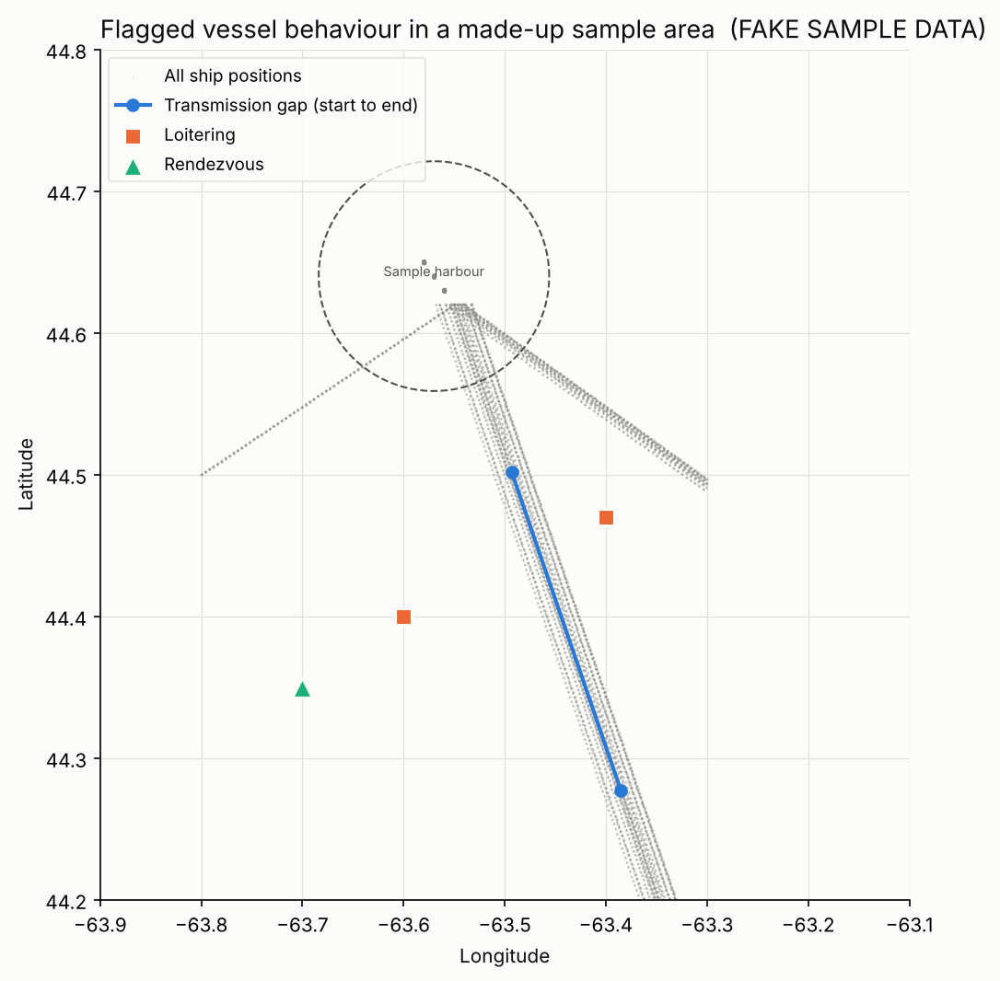
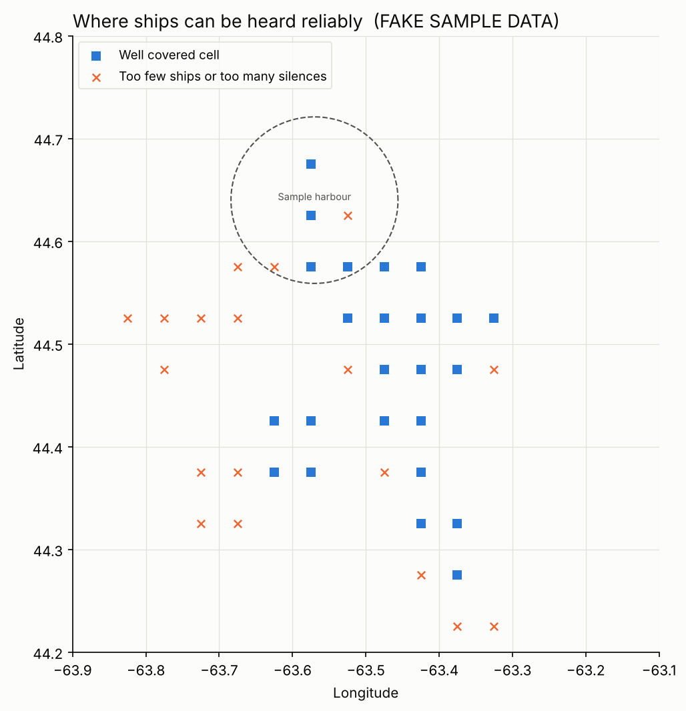

# Fundy Vessel Tracker

Built with AI-assisted development and human testing/oversight.  

**Finding unusual ship behaviour in the Bay of Fundy using public AIS data.**

Ships broadcast their position over radio using a system called AIS. This project collects those broadcasts for the waters around Saint John, New Brunswick, and looks for three kinds of behaviour that maritime analysts care about:

| Behaviour | What it means |
|---|---|
| **Transmission gap** | A moving ship stops broadcasting for an hour or more, then reappears somewhere else |
| **Loitering** | A ship sits almost still at sea, outside any port, for two hours or more |
| **Rendezvous** | Two ships stay within 500 m of each other at sea for 30 minutes or more |

---

## Results

> Live collection from aisstream.io hasn't started yet, so there are no real results.
The maps in this README come from the bundled sample data, which uses invented ships.
They show what the pipeline produces, not what is happening in the Bay of Fundy.
Run `python run_pipeline.py --sample` to reproduce them.

### What the output looks like

This picture was made from **fake sample data** that ships with the repo (`python run_pipeline.py --sample`). It only shows what the pipeline produces. It is not a finding.



---

## The main problem: silence does not mean a ship switched off

This is the most important idea in the project.

AIS broadcasts are picked up by receivers on shore. If a ship sails out of range of every receiver, it vanishes from the data even though its transponder is still on. If every long silence is flagged, the result is basically a map of where reception is bad.

The fix is based on one idea:

> If lots of *different* ships go silent in the same place, the problem is the place, not the ships.

So the pipeline:

1. Cuts the bay into grid cells about 5 km across.
2. Counts every time a ship passes through a cell as one "visit".
3. Measures what share of visits to each cell ended with the ship going silent.
4. Only trusts cells where at least 20 visits were recorded and at most 10% of them ended in silence.

A gap is only flagged if it **starts in a trusted cell**. On the fake sample data this takes 119 silences down to 1, which is the one that was planted.

There is a second version of the same problem. I collect the data myself, so if my computer goes to sleep, *every* ship goes silent at once. The pipeline spots this by looking for 10 minute windows where no ship at all was heard. A gap is ignored if the feed was down for much of it, or down during its first hour.



---

## Data

There is no free archive of historical AIS data for Canadian waters. The well known free archive, MarineCadastre.gov, only includes ships inside the United States Exclusive Economic Zone, which leaves out Saint John and most of the Bay of Fundy.

So this project builds its own dataset. `collect_ais.py` connects to [aisstream.io](https://aisstream.io), a free live AIS feed, and saves one position per ship per minute for as long as it is left running.

Full instructions are in **[docs/DATA_DOWNLOAD.md](docs/DATA_DOWNLOAD.md)**.

**Study area:** latitude 44.5 to 45.6, longitude -67.0 to -65.0. This covers Saint John harbour, the main shipping lane down the bay, the Digby ferry route and Grand Manan.

---

## How it works

```
collect_ais.py        live AIS feed  ->  data/raw/positions_YYYY-MM-DD.csv
        |
run_pipeline.py
        |
        |-- src/clean.py              remove junk and military ships, keep the study area, one ping per minute
        |-- src/coverage.py           work out which grid cells can be trusted
        |-- src/detect_gaps.py        find silences and apply six checks
        |-- src/detect_loitering.py   find slow runs outside ports
        |-- src/detect_rendezvous.py  find pairs of ships that stay close
        |-- src/make_map.py           draw the maps
        v
outputs/              CSV files, map.png, coverage_map.png, map.html, summary.txt
```

### Cleaning

| Problem in the raw data | What I do |
|---|---|
| Ship IDs that are not real ships (buoys, base stations, typos) | Keep only 9 digit IDs starting with 2 to 7 |
| "No position" codes (latitude 91, longitude 181) | Removed by the study area filter |
| "No speed" code (102.3 knots) | Set to missing |
| Duplicate messages | Removed |
| Many pings per minute from the same ship | Keep the first one each minute |
| GPS glitches | Remove a ping if the ship would have needed more than 50 knots to get there *and* to get back |
| Military ships (AIS type 35) | Removed. See [Military ships](#military-ships) |

### Gap detector

A silence of 60 minutes or more is flagged only if all six of these are true:

1. The ship was moving (at least 1 knot) just before it went silent.
2. The silence started in a well covered grid cell.
3. It did not start inside a port circle.
4. It did not start within 5 km of the edge of the study area.
5. The data feed was working for at least 90% of the silence, and for at least 90% of its first hour.
6. At least 80% of the straight line between where the ship vanished and where it came back runs through well covered cells.

Every silence is saved to `outputs/gaps_all_candidates.csv` with a True/False column for each check, so it is easy to see why something was or was not flagged.

### Loitering detector

Looks for a run of pings from one ship where every ping is under 2 knots, there is no silence longer than 15 minutes inside the run, the run lasts at least 2 hours, and its average position is outside every port circle.

The speed limit is 2 knots and not lower because the Bay of Fundy has some of the strongest tides in the world. A ship that is drifting can still show a knot or two.

### Rendezvous detector

Keeps only slow pings (under 3 knots) outside ports, puts them in 5 minute buckets, and joins the table to itself to get every pair of ships seen in the same bucket. Pairs within 500 m are kept, and buckets next to each other are joined into one event. Events shorter than 30 minutes are dropped.

### Routine ship types

Fishing boats, tugs, pilot boats, ferries and similar ships loiter and meet other ships as part of their job. They are not removed, because removing them would hide them from anyone checking my work. Instead they get a `likely_routine` column and are sorted to the bottom.

### Military ships

Warships often switch AIS off on purpose, so for them a transmission gap is normal and not a finding. A public list of when navy ships went silent is also not something this project should produce. Ships that report AIS type 35 (military) are removed during cleaning, before any detector runs.

This only works for ships that report their type. A military ship that sends no type, or a different one, is not removed, so I check the flagged ships by name during the hand review as well.

---

## Checking the results by hand

A detector is only useful if most of what it flags is real, so the top results get checked one at a time.

```
python review.py            # makes outputs/review_sheet.csv
python review.py --score    # after filling in the "label" column
```

For each event I look at the position and time on `outputs/map.html`, look up the ship, and label it `genuine`, `false_positive` or `unsure`. The score is the share of judged flags that were genuine.

There is no official list of "ships that really went dark", so this is my own judgement and not a true accuracy number.

---

## Limitations

- **Reception changes over time.** aisstream.io relies on volunteer receivers. If one goes offline for a week, a cell that looked well covered stops being well covered. The coverage map is one average over the whole collection period.
- **The path check is a straight line.** Ships do not sail in straight lines, so check 6 is only approximate.
- **Port circles are drawn by hand.** The positions and sizes in `config.py` are approximate. Anchorages outside the circles will show up as loitering.
- **The military filter depends on the ship reporting its type.** See [Military ships](#military-ships).
- **Small boats are mostly invisible.** Many small fishing and pleasure boats are not required to carry AIS.
- **AIS can be wrong on purpose.** A ship can broadcast a false position. This project only looks at silence, not at false positions.
- **No ground truth.** The hand review is my opinion.
- **Short collection period.** A few weeks of data cannot show seasonal patterns such as the lobster season or cruise ship season.

---

## How to run it

You need Python 3.10 or newer.

```
git clone https://github.com/ashutosh-agarwal-swe/fundy-vessel-tracker.git
cd fundy-vessel-tracker
pip install -r requirements.txt
```

**Try it on the fake sample data first** (takes a few seconds, needs no account):

```
python run_pipeline.py --sample
```

Then open `outputs_sample/map.html` in a browser.

**Run it on real data:** follow [docs/DATA_DOWNLOAD.md](docs/DATA_DOWNLOAD.md), then:

```
python run_pipeline.py
```

**Run the tests:**

```
pytest
```

The tests build the fake sample data, run the whole pipeline on it, and check that the planted events are found and that the dead zone, the feed outage and the fake warship are not flagged. The tests use their own made-up area, so changing the study area in `config.py` does not break them.

---

## Files

| File | What it does |
|---|---|
| `config.py` | Every setting: study area, port circles, thresholds, excluded ship types |
| `collect_ais.py` | Collects live AIS data from aisstream.io |
| `import_marinecadastre.py` | Plan B: imports US archive files if the study area is moved to US waters |
| `make_sample_data.py` | Makes fake data with known answers for testing |
| `run_pipeline.py` | Runs every step |
| `review.py` | Builds and scores the hand review sheet |
| `src/` | One file per pipeline step, plus shared helpers |
| `tests/` | Tests for cleaning, the detectors, the collector's message parser and the full pipeline |
| `docs/DATA_DOWNLOAD.md` | Step by step data instructions |

---

## What I would do next

- Collect for a full year to see seasonal patterns.
- Rebuild the coverage map week by week instead of once for the whole period.
- Replace the straight line path check with the routes ships actually take.
- Add satellite radar images (Sentinel-1 is free) to check whether a ship was really there during a gap.

## Data credit

Live AIS data from [aisstream.io](https://aisstream.io). All ships in `data/sample/` are invented.
